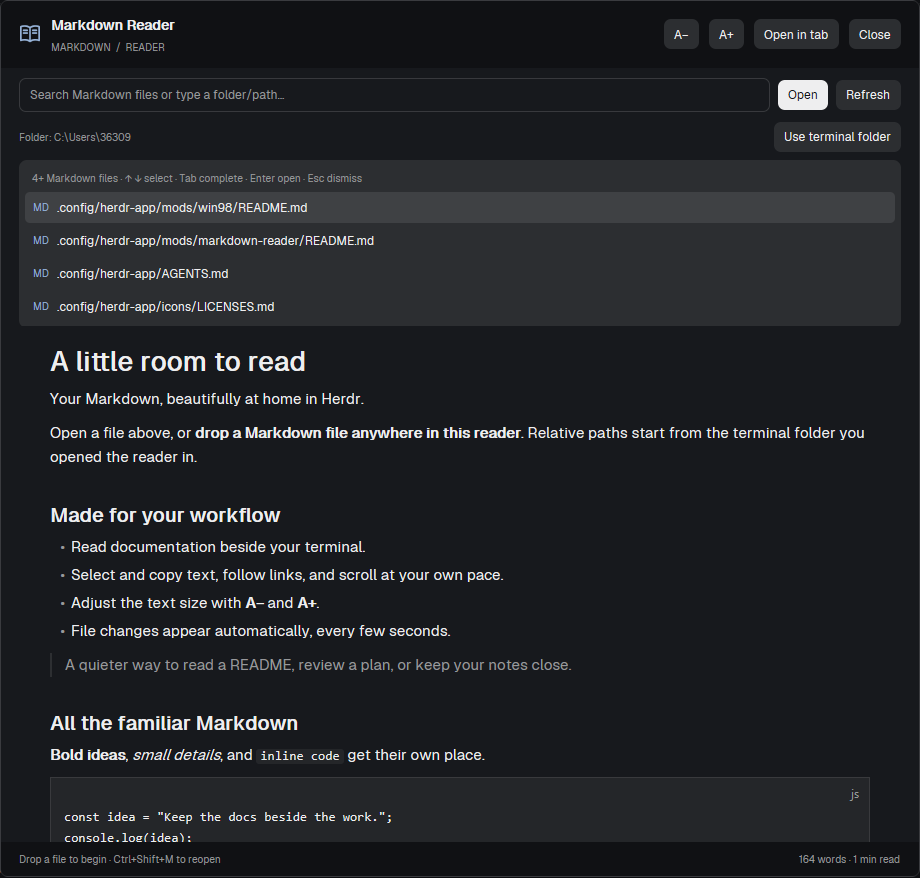

# Markdown Reader for Herdr

A native Markdown reader for [Herdr](https://herdr.dev), with filename search, live refresh, and a companion shortcut that opens documentation beside your terminal.

## Install

Give your coding agent this repository URL and ask it to install the mod using your `~/.config/herdr-app/AGENTS.md` instructions. Both mod folders are required.

For a manual installation:

1. Copy `mods/markdown-reader` and `mods/markdown-reader-pane` into `~/.config/herdr-app/mods/` (on Windows: `%USERPROFILE%\.config\herdr-app\mods\`). Do not overwrite an existing mod with the same name.
2. Merge the supplied `keys.json` bindings into your existing `keys.json`; do not replace your whole file. Resolve any shortcut conflicts first.
3. Run `herdr-app check` against each installed mod folder.
4. Press **Ctrl+Shift+M** to open the reader or **Ctrl+Shift+R** to split a reader to the right of your focused pane.

The supplied bindings also include **Command+Shift+M/R** for macOS. These are app shortcuts while Herdr is focused, not system-wide shortcuts.

## Read and search

Type part of a Markdown filename to search the terminal's working folder, or paste an absolute/relative file path. Arrow keys select suggestions, Tab completes a path, Enter opens it, and Escape dismisses suggestions. Ctrl+L focuses the path bar. Dropping a local file opens it.

Use **A− / A+** for text size (12–23 px), **Refresh** to reload and reindex, and **Use terminal folder** to change the search root. The reader checks an open file every five seconds. **Open in tab** moves an overlay reader into a new tab.

Text supports selection and copying, and Markdown links use Herdr's renderer. UTF-8 text files are limited to 1 MiB by Herdr. MDX files are read as Markdown; components are not executed.

## Compatibility and limitations

- Checked with Herdr **0.1.11 on Windows**. macOS and Linux have not been tested.
- Filename indexing uses **ripgrep (`rg`)**. Windows has a bounded PowerShell fallback. On macOS/Linux, install `rg` or open files directly by path.
- Folder-path suggestions use built-in POSIX `sh` features on macOS/Linux, avoiding GNU-specific `find` options. Hidden files are included and symlinks are skipped. Local Windows uses PowerShell.
- Index results stop at 3,000 files and suggestions at eight. The Windows fallback also limits traversal to 20,000 entries, 600 directories, and six levels below the root. Folder browsing reads up to 1,000 entries.
- Dependency/cache folders are skipped. Relative paths use the folder captured when the reader opened; **Use terminal folder** updates it.
- Remote files use Herdr's machine context; remote support has not been tested. Remote `~/` paths are not expanded by this mod.

## File and process access

The reader reads files outside its mod directory, including the working folder and file paths you choose. It runs `rg`, PowerShell on local Windows, or `sh` for file discovery. Directory paths are passed as process working directories, never interpolated into shell source. It does not directly call network-fetch APIs or upload document contents. Remote access, when selected, goes through Herdr's machine APIs. Markdown rendering and opening links are handled by Herdr.

## Development checks

Run `node --test tests/folders.test.cjs` with a recent Node.js version on Windows, macOS, or Linux. The tests exercise real directory listings, hidden and unusual filenames, empty directories, the 1,000-entry limit, and error/remote routing behavior. On Windows, setting `READER_TEST_SH` to a POSIX shell executable (or busybox.exe) also tests the Unix listing branch. Node.js is needed only for these development tests, not to use the mod.

See [RECIPE.md](RECIPE.md) for the build brief. No personal layouts, settings, saved state, or documents are included.
