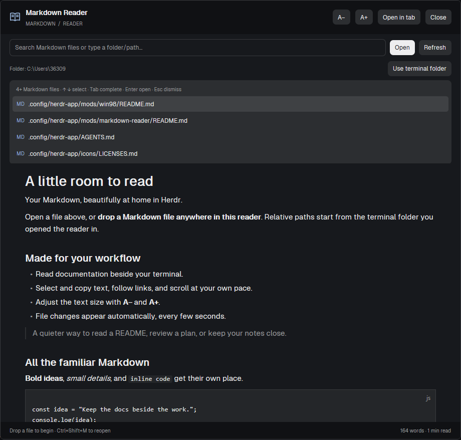

# Markdown Reader

A quiet native Markdown reading space in Herdr, opened as a dialog, a tab, or a pane beside a terminal. Search the current working folder, open a file, and keep it visible while working.

## What you see

The dialog is 920 px wide and 85% of the window height; a tab or split pane fills its available space. It uses Herdr theme colors throughout. At the top, a book icon and filename sit beside 30 px text-size buttons, Open in tab, and Close (the latter two only in an overlay). A path/search input, Open, and Refresh follow. A small row shows the base folder and Use terminal folder.

Suggestions appear only for a non-empty search or folder path, in a scrollable raised panel up to 250 px high, with at most eight matches. Each row has an MD or DIR label and a highlighted current selection. Errors appear above the document as a readable message. The selectable Markdown document sits in a scrolling region with 28 px horizontal padding, 18 px vertical padding, and a centered column at most 820 px wide. Text starts at 15 px. A footer shows refresh/loading state, word count, and estimated reading time at 220 words per minute.

## How it behaves

Ctrl+Shift+M (or the included Command binding) opens the dialog. Ctrl+Shift+R opens a reader pane to the right of the focused pane using the companion launcher. With no focused pane the launcher shows a notification. These are Herdr shortcuts, not OS-global bindings. There are no agent-status indicators or animations.

On opening, capture the focused terminal's working folder and the active space's machine. Focus the search input after the pane mounts, selecting any existing path. Keep the file list hidden until a non-empty query is entered; clearing the query or opening a file hides it. Focusing the input alone must not reopen suggestions. Index Markdown filenames recursively, preferring rg and skipping dependency/cache folders. Typing ranks names using exact, prefix, substring, and subsequence matches. Queries containing slashes browse the parent directory with a 140 ms debounce. Up/down wrap through suggestions, Tab completes, Enter opens a file or enters a folder, and Escape dismisses suggestions. Ctrl+L selects the path input. Clicking a suggestion performs the same action. Hover highlights buttons and suggestion rows.

Open reads the resolved path and rejects missing/binary files with a visible error. A dropped file switches to local machine context. Refresh reloads the document and rebuilds the index. Use terminal folder captures the current context again. Poll an open document every five seconds and update it when contents change. A−/A+ clamp the size to 12–23 px. Open in tab creates a new mod tab carrying file, cwd, and machine props, then closes the overlay. Close dismisses the dialog. Text selection, copying, links, and Markdown layout use the native renderer.

## Built from

There is no layout file. `mods/markdown-reader/main.js` defines a gpui-kit View using gpui-base InputState, Input, flex helpers, and TextView.markdown. `mod.json` sets place:none and dialog dimensions. `book.svg` is the only art asset. `search.js` normalizes paths, recognizes extensions, resolves paths, and ranks matches. `files.js` indexes with rg, falls back to bounded PowerShell on Windows, and lists directories with PowerShell or POSIX sh.

Herdr APIs: theme, props, focused, panes, spaces, home, readTextFile, exec, window, run, closeOverlay, nextCommand, and notify. Commands: tab.new and pane.split. The reader also accepts refresh/open commands through nextCommand. Props: file, cwd, on (machine), query, and overlay. Timers use cx.timer; async work uses cx.spawn with generation counters to ignore stale results. A failed edit must retain the last working build through Herdr hot reload.

`mods/markdown-reader-pane/main.js` is a one-pixel popup launcher that captures focus/context, closes itself after a 1 ms timer, and splits the captured pane. Its mod.json sets place:none and a 1×1 popup. The bundled keys.json is a merge snippet containing only reader shortcuts.

## Watch out

Use GPUI, not HTML, CSS, DOM, Node, or browser timers. Asset paths start at the Herdr home (`mods/markdown-reader/book.svg`). If mod folders are renamed, rewrite self-references, asset paths, and shortcut targets. Do not replace shipped mods, personal layouts, or the user's keys.json.

The code reads files outside its own directory and executes discovery programs; disclose this during installation. Do not ship personal files or state. Windows traversal skips reparse points and quotes PowerShell literals. Indexing limits: 3,000 files; Windows fallback 20,000 visited entries, 600 directories, six levels; folder listings 1,000 entries; visible suggestions eight. Files are subject to Herdr's 1 MiB read limit. MDX components are not executed. Home expansion is local only. Remote behavior is untested.

Non-Windows folder browsing uses only POSIX shell features: glob immediate children with ./*, ./.[!.]* and ./..?*, skip symlinks and non-file/non-directory entries, and emit NUL-separated type/name fields with printf. Keep the directory path in exec's cwd option, never in shell source. Stop after 1,000 entries before filtering Markdown extensions. Unmatched glob patterns are ignored through file tests, and . and .. are excluded. Do not introduce GNU find flags: macOS ships BSD find. Mac/Linux indexing still needs rg. Full app behavior has only been checked on Windows with Herdr 0.1.11. There are no intentionally inert controls.

## Done when

- Both mod folders pass `herdr-app check` and render in the running app.
- A fresh reader shows the welcome document and toolbar with search focused and the file list hidden. Typing a query reveals suggestions; clearing it hides them again.
- A known Markdown file opens by absolute and relative paths; a missing file shows an error.
- Filename suggestions can be selected with arrows and opened with Enter; Tab completes and Escape dismisses.
- Editing an open file updates the reader after five seconds; Refresh updates immediately.
- Text-size buttons respect their limits and text can be selected/copied.
- Open in tab carries the current file and context; the companion launcher creates a reader to the right of the focused pane.
- Shortcut installation preserves existing bindings and resolves conflicts.
- `node --test tests/folders.test.cjs` passes for folder browsing, including hidden/unusual names, empty folders, the entry limit, and remote command routing.
- The README distinguishes portable folder browsing from the untested full Mac/Linux app integration.
